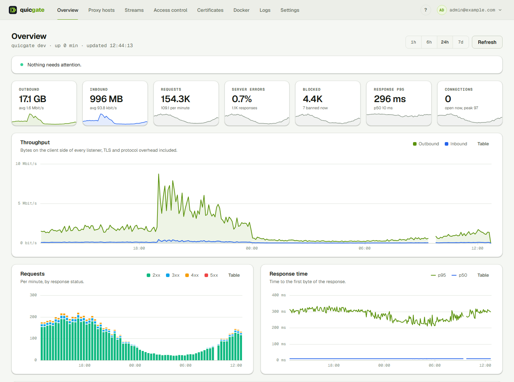
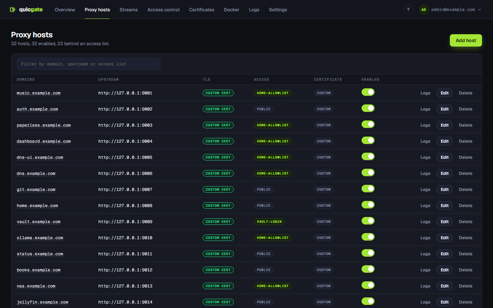
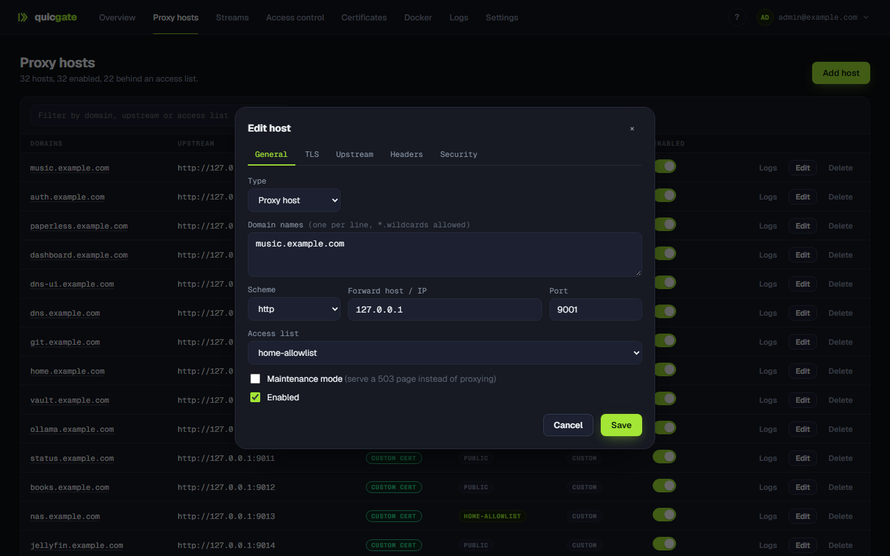
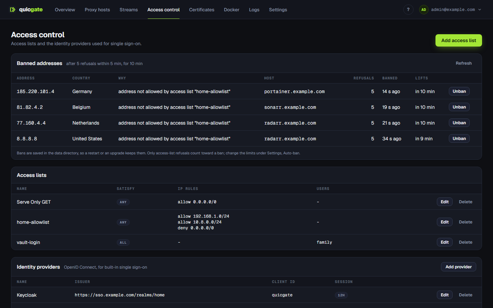
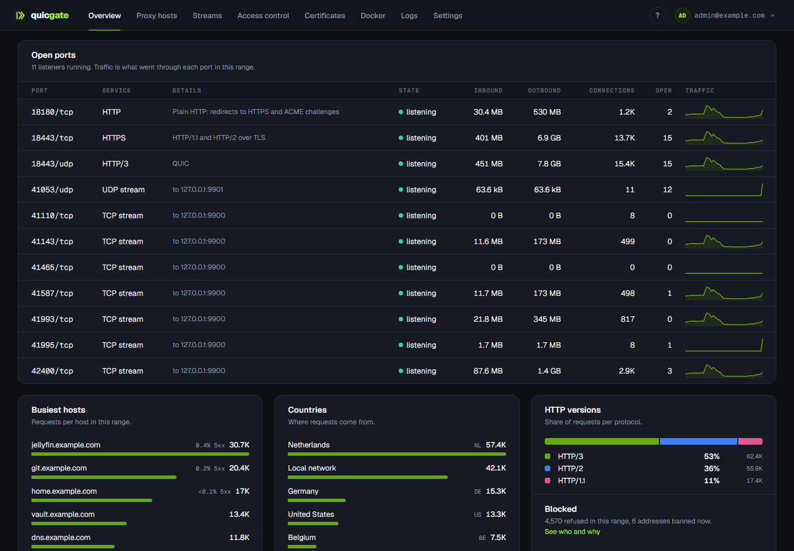

<p align="center">
  <picture>
    <source media="(prefers-color-scheme: dark)" srcset="brand/logo-full-dark.svg">
    
  </picture>
</p>

<h3 align="center">A reverse proxy you manage from a web page, in one small program.</h3>

<p align="center">
  Add a host, get a certificate, decide who may come in, and watch the traffic.<br>
  <b>One Go binary in one 25 MB container. No nginx or Traefik underneath, nothing to run beside it.</b>
</p>

<p align="center">
  <a href="https://github.com/Quicgate/quicgate/releases"></a>
  <a href="https://github.com/Quicgate/quicgate/actions/workflows/docker.yml"></a>
  <a href="LICENSE"></a>
  
  
  <a href="https://github.com/Quicgate/quicgate/stargazers"></a>
</p>

<p align="center">
  <a href="#quick-start">Quick start</a> &middot;
  <a href="#a-look-around">Screenshots</a> &middot;
  <a href="#what-you-get">Features</a> &middot;
  <a href="#how-it-compares">Comparison</a> &middot;
  <a href="#what-to-know-before-you-rely-on-it">Caveats</a> &middot;
  <a href="#documentation">Docs</a>
</p>

<p align="center">
  <picture>
    <source media="(prefers-color-scheme: dark)" srcset="brand/screenshots/overview-dark.png">
    
  </picture>
</p>

quicgate puts your self-hosted services on the internet, or keeps them off it. You add a host
in the web UI: a domain name and the address of the service behind it. quicgate fetches the
certificate, serves the site over HTTP/1.1, HTTP/2 and HTTP/3, and lets you say who is allowed
in. If you have used Nginx Proxy Manager, the workflow will feel familiar. The difference is
underneath: quicgate is its own proxy, written in Go, so there is no nginx to reload and no
generated config file to go wrong.

> **It is young, and it is in daily use.** quicgate has carried all the traffic of my own
> homelab since July 2026, and a new release comes out most weeks. If you try it, I would like
> to hear how it went: what worked, what broke, what confused you, what you missed.
> [Open an issue](https://github.com/Quicgate/quicgate/issues), it does not have to be a bug.
> Read [what to know before you rely on it](#what-to-know-before-you-rely-on-it) first.

## Why quicgate

Most homelabs grow the same pile of tools: a proxy, a UI to manage it, something for
certificates, something for logins, fail2ban, a metrics exporter and a log viewer. quicgate is
that pile as one program, with a UI you can hand to someone else.

- **A new host takes a few seconds.** Type the domain and where the service lives, then save.
  The certificate is requested for you and the host answers right away. Nothing restarts.
- **Logins without a second service.** quicgate can send visitors to your identity provider
  (Keycloak, Entra ID, Authentik, anything that speaks OpenID Connect) before they reach a
  service. You choose this per host, or per URL on a host.
- **HTTP/3 on every host.** It is on from the start, and you can turn it off per host.
- **You can see what is going on.** A week of traffic charts, every open port with its
  throughput, the busiest hosts, where visitors come from, and who was refused and why.
- **A typo cannot take the proxy down.** Every option is a field that is checked when you save.
  There is no box for raw config, on purpose. If quicgate cannot do something through a field,
  it cannot do it, and that is a fair reason to pick another tool.
- **Small enough to check.** One static binary in an otherwise empty image. Each release is
  scanned for known vulnerabilities and signed, and you can verify the signature yourself.

> I liked the way Nginx Proxy Manager works but not what is inside it, and I liked Pangolin's
> engine but not how many parts it has. So quicgate keeps the click-and-save workflow and puts
> it on a proxy written for the job, in one piece. It is the only way into my homelab, for
> about 45 hosts plus mail and media streams.

## Quick start

```yaml
# docker-compose.yml
services:
  quicgate:
    image: ghcr.io/quicgate/quicgate:latest
    restart: unless-stopped
    network_mode: host      # quicgate listens on 80 and 443 (TCP and UDP); the admin UI is on 81
    environment:
      - QG_ACME_EMAIL=you@example.com
    volumes:
      - ./data:/data
```

```bash
docker compose up -d
```

Open `http://<host>:81` and sign in with `admin@example.com` and the password `changeme`. You
have to pick a new password straight away, and you can change the sign-in address to your own
under Account & security. Then add your first proxy host and watch the certificate arrive.

> [!WARNING]
> Do not open port 81 to the internet. Reach the admin UI over your own network or a VPN, or
> put it behind quicgate itself with an access list, like any other private service.

The `:1` tag follows the 1.x releases: you get fixes, and a future 2.0 never arrives by itself.

Would you rather use bridge networking, or have quicgate open the ports on your router over
UPnP? The comments in [`docker-compose.yml`](docker-compose.yml) and the
[getting started guide](web/docs/getting-started.md) cover both.

## A look around

| | |
|---|---|
| [](brand/screenshots/hosts.png) | [](brand/screenshots/host-edit.png) |
| **Proxy hosts.** One screen shows where each host points, its certificate, which access list guards it, and its own log. | **Editing a host.** Certificates, upstreams, header rules and security each have a tab with plain fields. |
| [](brand/screenshots/access.png) | [](brand/screenshots/ports.png) |
| **Access control.** Access lists, identity providers, and the addresses that are banned right now, each with the reason. | **Open ports.** Every port quicgate listens on with its traffic, plus the busiest hosts, countries and HTTP versions. |

## What it replaces

| Instead of | quicgate gives you |
|---|---|
| Nginx Proxy Manager, nginx | proxy hosts, certificates, redirects, static sites, and the UI |
| Traefik, Caddy | routing, automatic certificates, hosts from Docker labels, HTTP/3 |
| Authelia, oauth2-proxy, Pomerium | login through your identity provider, rules by group, the user's name passed to the app |
| fail2ban, an exporter, a log viewer | automatic bans, Prometheus metrics, access logs you can read in the UI |

## Logins for your services

With most proxies, single sign-on means running a second service next to the proxy. quicgate
does the OpenID Connect login itself.

You set up an identity provider once. After that you choose per host who gets in: by email
address, by email domain or by group. If the app behind the host understands proxy logins,
quicgate can pass the user on as `Remote-User`, `Remote-Email` and `Remote-Groups`, so people
are signed in to the app as well. A visitor cannot fake those headers: quicgate removes any
copy that comes in from outside.

Rules can differ per URL on the same host. Real apps need that:

| Path | Who gets in |
|---|---|
| `/ValidationService.asmx` | everyone: a licensing callback that cannot log in |
| `/webhooks/` | everyone, `POST` only |
| `/admin/` | people who logged in and are in the group `platform-admins` |
| everything else | anyone who logged in |

Different paths can use different identity providers, for example staff on the company's and a
partner on their own. If you already run Authelia or Authentik, you can keep it: point a host
at its check address and quicgate asks it about every request (forward auth). The
[access control and SSO guide](web/docs/sso.md) has the details.

## What you get

<details open>
<summary><b>Hosts</b></summary>

- Four kinds of host: proxy to a service, redirect, a plain 404, or a folder of static files
- Wildcard domains
- Several upstreams behind one host, with health checks and sticky sessions
- Custom locations: send one path to a different upstream
- Path rewrites: strip a prefix, add one, or rewrite with a regular expression
- Maintenance mode, response caching and gzip
- Header rules for requests and responses
</details>

<details open>
<summary><b>Certificates and HTTP/3</b></summary>

- Automatic certificates from Let's Encrypt, or from another ACME authority such as ZeroSSL or
  your own step-ca
- Wildcard certificates through a DNS challenge (DNS-01)
- Your own certificates: upload them, or let quicgate make a self-signed one
- Client certificates (mTLS) for hosts that should only answer known devices
- HSTS
- HTTP/1.1, HTTP/2 and HTTP/3 on every host
</details>

<details open>
<summary><b>Who gets in</b></summary>

- Access lists with ordered rules: by IP address or range, by a dynamic DNS name, or by country
- Rules that apply to some HTTP methods only, for example anyone may `GET` but only the office
  may `POST`
- Basic auth, login through your identity provider, or forward auth
- Different rules per URL on one host
- Rate limits, and filters for common exploit probes and bad bots
- Automatic bans for addresses that keep misbehaving, with a never-ban list so you cannot lock
  yourself out
- The real visitor address when quicgate sits behind Cloudflare or another load balancer
</details>

<details>
<summary><b>TCP and UDP streams</b></summary>

- Forward any TCP or UDP port, or a range of ports, to a service
- Limit a stream to the addresses on an access list
- PROXY protocol v1 and v2, in and out
- End TLS on a stream, or route by server name without opening the connection
- Port forwards on your router kept in place over UPnP, also after the router restarts
</details>

<details>
<summary><b>WireGuard: other networks, and a VPN for people</b></summary>

WireGuard is built in. It runs inside quicgate and needs no extra privileges, no network
device and no change to the machine's routing. It does three separate things, and each is off
until you switch it on.

- **Sites.** Reach services on a network quicgate is not on, through an ordinary WireGuard
  peer at the other end: a router, a small Linux box, a VPS. It works the other way round too,
  with quicgate on a VPS and your home network calling in.
- **Devices and the portal.** Hosts can exist inside the tunnel only, so from outside they look
  like they are not there. People sign in to a portal with single sign-on and add their own
  phone or laptop. quicgate checks with the identity provider every few minutes whether they
  are still allowed.
- **LAN access (experimental).** People who signed in can reach parts of your home network,
  with a policy per group and a log of every connection. The admin UI can never be reached this
  way.
</details>

<details>
<summary><b>Docker</b></summary>

- Put `quicgate.enable=true` on a container and quicgate makes the host, and any streams, from
  its labels
- Flat labels: a domain, a port, the options you want
- More than one Docker machine
- Every host made from labels shows why it is, or is not, being served
- A host you made by hand always wins over one from a label
</details>

<details>
<summary><b>IPv6</b></summary>

- Visitors and upstreams on IPv6
- IPv6 ranges in access lists and trusted proxy lists
- Country rules and rate limits work the same on IPv6
</details>

<details>
<summary><b>Running it</b></summary>

- An overview page with a week of traffic charts
- Access logs with a viewer in the UI, and Prometheus metrics at `/metrics`
- Backup and restore in one click
- Import a whole setup from one JSON file, safely repeatable
- A warning before a certificate expires (ntfy, Gotify)
- Two-factor login for the admin, or admin login through OpenID Connect or LDAP
- API tokens for scripts
- Secrets in the database are encrypted
- Guides built into the UI that work without internet
- Light and dark, and a choice of themes
</details>

[FEATURES.md](FEATURES.md) lists every feature with two answers: is it covered by tests, and
has it been used on real infrastructure. It also lists what was planned and not built.

## How it compares

| | **quicgate** | **Nginx Proxy Manager** | **Pangolin** |
|---|---|---|---|
| The proxy inside | its own, written in Go | nginx | Traefik |
| What you run | **1 container, about 25 MB** | 1 container (plus an optional database) | 3 or more containers |
| HTTP/3 | **on by default, switch per host** | no | through Traefik config |
| How you configure it | **checked fields only** | UI plus free-text nginx snippets | UI plus Traefik config |
| When a change applies | at once, nothing reloads | nginx reload | Traefik picks it up |
| Logins for your services | **built in, plus forward auth** | no | **built in, with its own identity provider** |
| Rules per URL | **yes** | no | per resource |
| Access lists | addresses, **countries, dynamic DNS names** | addresses | yes |
| TCP and UDP streams | yes, with PROXY protocol, routing by server name and TLS | basic | through tunnels |
| Services on other networks | **WireGuard sites**, any WireGuard peer, no agent to install | no | **yes, mature, with its own agent** |
| VPN for people's devices | WireGuard devices, a portal with single sign-on, experimental LAN access | no | **yes, mature** |
| Hosts from container labels | **yes, also streams** | no | through Traefik labels |
| Metrics and API | Prometheus, a full REST API with an OpenAPI description | none, REST undocumented | through Traefik, REST |
| How proven | **young, read the caveats below** | many years, huge community | growing fast |

**Pick Nginx Proxy Manager** if you want the option with the most years behind it and an
answer to every question already on a forum somewhere.
**Pick Pangolin** if tunnels are the centre of your setup. It is built around them, with its
own agent and access rules per user.
**Pick quicgate** if you want one small container that covers the proxy, the certificates, the
access rules and the logins.

### What to know before you rely on it

- **It is young.** It runs one homelab in production and changes quickly, so expect rough
  edges. Tell me about them in an [issue](https://github.com/Quicgate/quicgate/issues). "This
  confused me" is as useful as a bug report.
- **Not everything has met the real world.** The built-in login, for one, is tested against a
  made-up identity provider in the test suite. Try it against yours before you depend on it.
  [FEATURES.md](FEATURES.md) says per feature what has run on real infrastructure and what is
  only tested.
- **The WireGuard parts are the newest.** Sites, devices and the portal are well tested but
  have little time in production behind them. LAN access is marked experimental: an outside
  review found twelve defects, all fixed since, and those fixes have not been reviewed from
  outside yet. It is also not a full-tunnel VPN and not a mesh.
- **One admin.** There is a single admin account, with two-factor login or login through
  OpenID Connect or LDAP. There are no roles and there is no log of who changed what. An API
  token can do everything the admin can and does not expire.
- **No raw config.** If you depend on a hand-written nginx snippet, quicgate has no place to
  put it.

## Security work

A security scan of the whole project in September 2026 led to release 1.18.0, which fixed what
it found; each fix came with a test that fails without it. The record is in
[SECURITY.md](SECURITY.md). Since then the API reference and the OpenAPI document also require
signing in, so the list of management endpoints is no longer readable by anyone who asks.

If you find a vulnerability, please report it privately as described in
[SECURITY.md](SECURITY.md), not in a public issue.

## Performance

On a Ryzen 7 9800X3D: about 45,000 proxied requests per second to a local backend, about
180,000 per second for cache hits, and about 8,900 per second with TLS on a single core. Access
lists add nothing you can measure. These are short benchmarks on one machine, not a long load
test, and logins, TLS and your own backends change the picture. Measure your own workload. You
can repeat mine with `go test -bench=. ./internal/engine`; [BENCHMARKS.md](BENCHMARKS.md)
explains the method.

## Checking what you run

Release images are built by CI for amd64 and arm64, from a base image pinned by its digest. A
release is only published when the vulnerability check passes. Each image carries a signed
record of how it was built, which you can verify:

```bash
gh attestation verify oci://ghcr.io/quicgate/quicgate:latest --owner Quicgate
```

The quick start uses `:latest`, which always points at the newest release. If you would rather
pin, use `ghcr.io/quicgate/quicgate:1` to follow the 1.x line, or a full version such as `:1.18.6`
to stay on one release until you choose to move.

## Documentation

The guides live in [`web/docs/`](web/docs/) and are also built into the program: open Help
(the `?` in the top bar) and pick one. They work without internet.

- [Getting started](web/docs/getting-started.md): run it, your first host, certificates, kinds of host, themes
- [Configuration reference](web/docs/configuration.md): environment variables and settings, real visitor addresses, country rules, HTTP/3, IPv6
- [Access control and SSO](web/docs/sso.md): access lists, logins, forward auth, rules per URL, the security model
- [Docker labels](web/docs/docker.md): hosts and streams from container labels
- [Streams and port forwards](web/docs/streams.md): TCP and UDP forwarding, PROXY protocol, routing by server name, UPnP, WireGuard sites
- [VPN](web/docs/vpn.md): devices, the portal and LAN access

## API

Everything the UI does is a REST call, so everything can be scripted. Once you are signed in,
the interactive reference is at `/docs.html` and the OpenAPI document at `/openapi.yaml`. The
same material in prose is in [API.md](API.md). Make a token under the account menu, API
tokens:

```bash
curl -H "Authorization: Bearer $TOKEN" http://<host>:81/api/hosts
```

`POST /api/import` takes a whole setup as JSON and can be run again and again with the same
result. That is how I scripted my own moves from Nginx Proxy Manager and Pangolin.

## Building from source

```bash
go build .                   # one static binary
docker build -t quicgate .   # the release image
```

To run it for development without TLS:
`QG_TLS=off QG_HTTP=:8090 QG_ADMIN=:8091 QG_DATA=./devdata go run .`

## Project

- [SPEC.md](SPEC.md): how quicgate compares to Nginx Proxy Manager feature by feature, and the design decisions
- [SPEC-wireguard.md](SPEC-wireguard.md): the WireGuard design, what it defends against, and its review record
- [ROADMAP.md](ROADMAP.md): what is done and what comes next
- [CHANGELOG.md](CHANGELOG.md): what changed, release by release
- [CONTRIBUTING.md](CONTRIBUTING.md): quicgate is opinionated on purpose (one binary, checked fields, no raw config)
- [SECURITY.md](SECURITY.md): how to report a vulnerability

If quicgate saves you a container or three, a star helps other self-hosters find it.

## License

[MIT](LICENSE)
